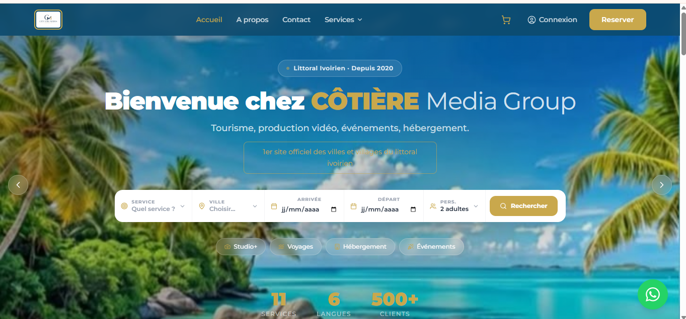
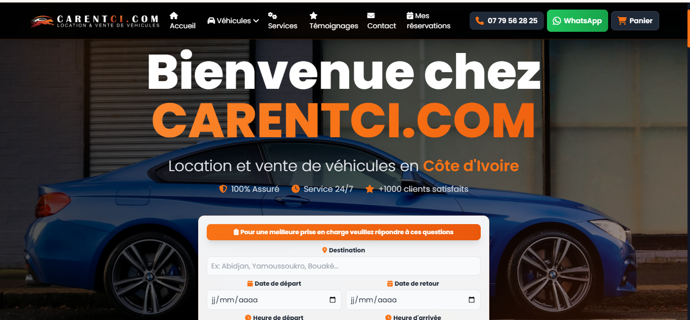
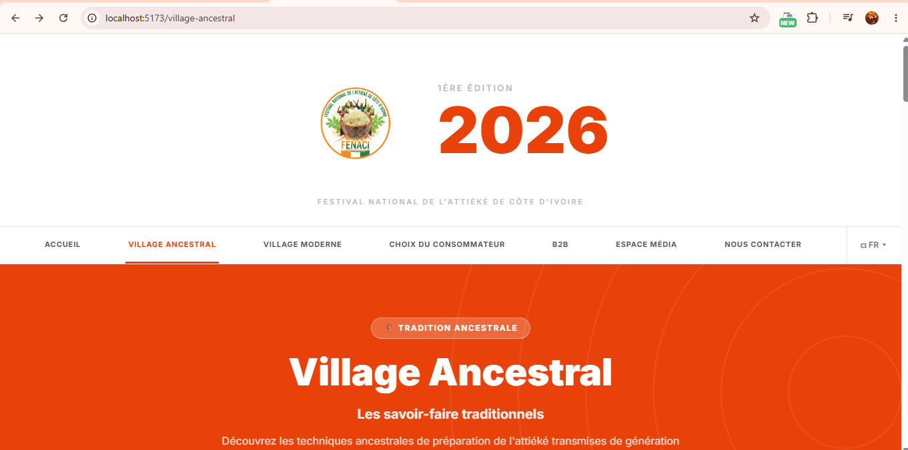

# 📝 Guide des Témoignages LinkedIn

## 🎯 Objectif

Remplacer les témoignages génériques (Larry Page, Mark Zuckerberg, Jack Dorsey) par **de vraies recommandations LinkedIn** de personnes avec qui vous avez travaillé.

---

## ⭐ Pourquoi c'est important ?

- ✅ **Crédibilité** : Témoignages vérifiables augmentent la confiance
- ✅ **Authenticité** : Vrais profils LinkedIn = preuve sociale
- ✅ **SEO** : Les noms réels améliorent le référencement
- ✅ **Réseau** : Montre vos connexions professionnelles

---

## 📋 Comment obtenir des témoignages ?

### Option 1 : Recommandations LinkedIn (Recommandé)

1. **Allez sur LinkedIn** → Votre profil → Section "Recommandations"
2. **Cliquez sur "Demander une recommandation"**
3. **Choisissez 3-5 personnes :**
   - Anciens managers/superviseurs
   - Collègues de travail
   - Clients satisfaits
   - Collaborateurs de projets
4. **Message type à envoyer :**

```
Bonjour [Prénom],

J'espère que tu vas bien ! Je mets actuellement à jour mon portfolio professionnel 
et j'aimerais inclure quelques témoignages de personnes avec qui j'ai eu le plaisir 
de travailler.

Pourrais-tu m'écrire une courte recommandation LinkedIn (2-3 phrases) sur notre 
collaboration et les compétences que tu as pu observer chez moi ?

Merci beaucoup pour ton temps !

Cordialement,
Claver
```

### Option 2 : Email direct

Si la personne n'est pas sur LinkedIn, envoyez un email :

```
Objet : Demande de témoignage pour mon portfolio

Bonjour [Prénom],

Je suis en train de finaliser mon portfolio professionnel et j'aimerais y inclure 
un témoignage de votre part concernant notre collaboration sur [nom du projet/entreprise].

Pourriez-vous me fournir :
- Une courte recommandation (2-3 phrases)
- Votre titre professionnel actuel
- Votre photo professionnelle (optionnel)
- Le lien vers votre profil LinkedIn (si vous en avez un)

Merci infiniment pour votre aide !

Claver Kouakou Kouame
claverkouame04@gmail.com
+225 07 48 20 88 65
```

---

## ✍️ Template de témoignage idéal

Un bon témoignage contient :

1. **Ce que vous avez fait ensemble** (projet, rôle, durée)
2. **Vos compétences clés observées** (technique, soft skills)
3. **Le résultat/impact** (livraison, performance, qualité)

### Exemple 1 : Manager/Superviseur

```
"J'ai managé Claver pendant 2 ans chez [Entreprise]. Il a développé notre 
plateforme e-commerce de A à Z avec Laravel et React. Code propre, livraison 
dans les délais, excellente communication. Un développeur full stack très 
professionnel que je recommande sans hésitation."

— Jean Dupont
CTO @ TechCorp
linkedin.com/in/jeandupont
```

### Exemple 2 : Collègue/Pair

```
"Claver et moi avons collaboré sur plusieurs projets DevOps chez [Entreprise]. 
Sa maîtrise de Docker, Kubernetes et CI/CD est impressionnante. Toujours 
disponible pour aider l'équipe, proactif dans la résolution de problèmes. 
Un vrai plaisir de travailler avec lui."

— Marie Martin
DevOps Engineer @ CloudServices
linkedin.com/in/mariemartin
```

### Exemple 3 : Client

```
"Claver a développé notre site web institutionnel en 3 mois. Interface moderne, 
responsive parfait, performances excellentes. Il a su comprendre nos besoins et 
proposer des solutions adaptées. Très satisfait du résultat et de sa réactivité."

— Pierre Kouassi
Directeur @ FENACI
linkedin.com/in/pierrekouassi
```

---

## 🖼️ Photos des témoignages

### Où trouver les photos ?

1. **LinkedIn** : Téléchargez la photo de profil de la personne
2. **Demander directement** : Email avec la demande de témoignage
3. **Format recommandé** : Carré 400x400px minimum

### Nom des fichiers

Placez les photos dans `c:\Users\abdou\Portfolio\images\` :

```
testimonial-jean-dupont.jpg
testimonial-marie-martin.jpg
testimonial-pierre-kouassi.jpg
```

---

## 💻 Comment remplacer dans index.html ?

### Étape 1 : Trouver la section (ligne ~5032)

Cherchez `<!-- Recommandations -->` ou `#recommendations`

### Étape 2 : Remplacer un témoignage

**Avant (Larry Page) :**

```html
<div class="carousel-item active">
    <div class="testimonial-item text-center mx-auto" style="max-width: 800px;">
        <div class="testimonial-img mb-4">
            
        </div>
        <div class="testimonial-content bg-dark-soft p-4 rounded-4">
            <div class="quote-icon mb-3">
                <i class="fas fa-quote-left text-primary fa-2x opacity-25"></i>
            </div>
            <p class="mb-4 text-light fst-italic fs-5">
                "Développeur web exceptionnel ! Son expertise technique et sa capacité 
                à livrer des projets de haute qualité dans les délais sont remarquables."
            </p>
            <h5 class="text-white mb-1">Larry Page</h5>
            <p class="text-primary mb-0">
                <i class="fab fa-google me-2"></i>Co-Founder @ Google
            </p>
        </div>
    </div>
</div>
```

**Après (Jean Dupont - VRAI) :**

```html
<div class="carousel-item active">
    <div class="testimonial-item text-center mx-auto" style="max-width: 800px;">
        <div class="testimonial-img mb-4">
            <picture>
                <source srcset="images/webp/testimonial-jean-dupont.webp" type="image/webp">
                
            </picture>
        </div>
        <div class="testimonial-content bg-dark-soft p-4 rounded-4">
            <div class="quote-icon mb-3">
                <i class="fas fa-quote-left text-primary fa-2x opacity-25"></i>
            </div>
            
            <!-- ⭐ Rating (optionnel) -->
            <div class="rating mb-3">
                <i class="fas fa-star text-warning"></i>
                <i class="fas fa-star text-warning"></i>
                <i class="fas fa-star text-warning"></i>
                <i class="fas fa-star text-warning"></i>
                <i class="fas fa-star text-warning"></i>
            </div>
            
            <p class="mb-4 text-light fst-italic fs-5">
                "J'ai managé Claver pendant 2 ans chez TechCorp. Il a développé notre 
                plateforme e-commerce de A à Z avec Laravel et React. Code propre, 
                livraison dans les délais, excellente communication. Un développeur 
                full stack très professionnel que je recommande sans hésitation."
            </p>
            
            <h5 class="text-white mb-1">Jean Dupont</h5>
            <p class="text-primary mb-2">
                <i class="fas fa-briefcase me-2"></i>CTO @ TechCorp
            </p>
            
            <!-- 🔗 Lien LinkedIn vérifiable -->
            <a href="https://linkedin.com/in/jeandupont" 
               target="_blank" 
               class="btn btn-sm btn-outline-primary mt-2">
                <i class="fab fa-linkedin me-1"></i> Voir profil LinkedIn
            </a>
        </div>
    </div>
</div>
```

### Étape 3 : Convertir la photo en WebP

```bash
cd c:\Users\abdou\Portfolio\images
sharp -i testimonial-jean-dupont.jpg -o webp/testimonial-jean-dupont.webp -f webp -q 80
```

---

## 🎨 Améliorations visuelles (optionnel)

### Ajouter un badge "Vérifié LinkedIn"

```html
<span class="badge bg-success ms-2">
    <i class="fab fa-linkedin me-1"></i> Vérifié
</span>
```

### Ajouter la date de collaboration

```html
<p class="text-muted small mb-0">
    <i class="far fa-calendar me-1"></i> Collaboration : Janvier 2023 - Mars 2025
</p>
```

### Ajouter l'entreprise logo (si disponible)

```html
<div class="company-logo mt-3">
    
</div>
```

---

## ✅ Checklist avant de publier

```
□ J'ai obtenu 3-5 témoignages authentiques
□ J'ai les photos professionnelles de chaque personne
□ J'ai vérifié que les profils LinkedIn existent
□ J'ai demandé l'autorisation d'utiliser leur nom et photo
□ Les témoignages sont spécifiques (projets, compétences, résultats)
□ Les photos sont converties en WebP
□ Les liens LinkedIn sont corrects
□ J'ai testé le carousel sur mobile et desktop
```

---

## 🚨 Erreurs à éviter

❌ **Inventer des témoignages** → Perte totale de crédibilité  
❌ **Utiliser des célébrités** (Larry Page, Zuckerberg) → Pas crédible  
❌ **Témoignages trop vagues** → "Claver est super" (inutile)  
❌ **Photos génériques** → Utiliser des avatars/stock photos  
❌ **Liens cassés** → Vérifier que les profils LinkedIn existent  

---

## 🎯 Alternatives si vous n'avez pas encore de témoignages

### Option 1 : Masquer temporairement la section

Commentez la section dans `index.html` :

```html
<!-- SECTION TEMPORAIREMENT MASQUÉE
<section id="recommendations">
    ...
</section>
-->
```

Et retirez le lien du menu :

```html
<!-- <a class="nav-link" href="#recommendations">Recommandations</a> -->
```

### Option 2 : Remplacer par "Clients satisfaits"

```html
<section id="clients" class="py-5">
    <h2>Clients & Collaborations</h2>
    <div class="row">
        <div class="col-md-4">
            
            <p>Développement plateforme web</p>
        </div>
        <div class="col-md-4">
            
            <p>Site de location de véhicules</p>
        </div>
        <div class="col-md-4">
            
            <p>Plateforme événementielle</p>
        </div>
    </div>
</section>
```

---

## 📞 Besoin d'aide ?

Si vous avez besoin d'aide pour :
- Rédiger les messages de demande
- Structurer les témoignages
- Implémenter le code HTML
- Convertir les images

Contactez-moi directement ou suivez ce guide étape par étape.

---

## 📌 Ressources utiles

- **LinkedIn** : https://www.linkedin.com/in/kouame-claver-kouakou-525b721ab/
- **Recommandations LinkedIn** : https://www.linkedin.com/help/linkedin/answer/a549031
- **Sharp-CLI** : https://www.npmjs.com/package/sharp-cli
- **Testimonial Templates** : https://www.testimonialsamples.com/

---

**Dernière mise à jour** : Janvier 2025  
**Auteur** : Claver Kouakou Kouame  
**Email** : claverkouame04@gmail.com

---

## 🎬 Résumé rapide (TL;DR)

1. Demander 3-5 recommandations LinkedIn
2. Télécharger leurs photos de profil
3. Convertir les photos en WebP avec `sharp-cli`
4. Remplacer le HTML dans `index.html` (section #recommendations)
5. Vérifier que les liens LinkedIn fonctionnent
6. Tester sur mobile et desktop

**Temps estimé** : 2-3 heures (incluant attente des réponses)
